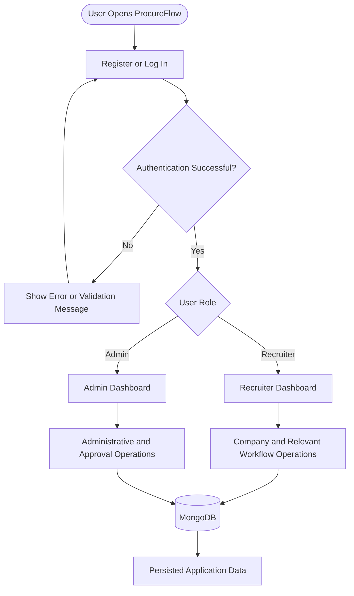
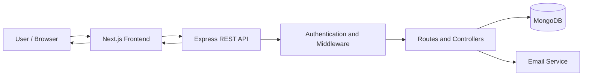

# 🚀 ProcureFlow

### A Smarter Way to Manage Company Onboarding, Approvals & Access

<p align="center">
  <a href="https://procureflow-topaz.vercel.app/"><strong>🌐 Explore Live Demo</strong></a> ·
  <a href="https://procureflow-4.onrender.com/api/health"><strong>⚡ API Status</strong></a> ·
  <a href="https://github.com/tannu01-dev/procureflow-"><strong>💻 Source Code</strong></a>
</p>

<p align="center">
  
  
  
  
  
  
</p>

---

## 📖 About ProcureFlow

**ProcureFlow** is a full-stack web application designed to bring structure, security, and visibility to company onboarding and approval-oriented workflows.

Instead of treating registration, authentication, company status, and access management as disconnected tasks, ProcureFlow brings these operations together through a centralized application backed by a REST API and database.

The application is built with **Next.js, Node.js, Express.js, and MongoDB**, with a deployed frontend on Vercel and backend on Render.

## 🌐 Experience the Application

| Resource | Access |
|---|---|
| 🌍 Live Application | [procureflow-topaz.vercel.app](https://procureflow-topaz.vercel.app/) |
| ⚡ Backend Health Endpoint | [Check API Health](https://procureflow-4.onrender.com/api/health) |
| 📦 GitHub Repository | [tannu01-dev/procureflow-](https://github.com/tannu01-dev/procureflow-) |

---

## ✨ What Makes ProcureFlow Useful?

<table>
<tr>
<td width="50%" valign="top">

### 🔐 Secure Authentication

User registration and login backed by password hashing and token-based authentication.

</td>
<td width="50%" valign="top">

### 🏢 Company Onboarding

A structured registration process that allows company information and registration status to be managed.

</td>
</tr>
<tr>
<td width="50%" valign="top">

### 👥 Role-Oriented Access

Admin and recruiter experiences designed around distinct application responsibilities and access levels.

</td>
<td width="50%" valign="top">

### ✅ Approval Workflows

Backend functionality for approval-related operations and controlled status handling.

</td>
</tr>
<tr>
<td width="50%" valign="top">

### 📧 Password Recovery

An email-based password recovery workflow using the application's configured mail service.

</td>
<td width="50%" valign="top">

### 📝 Audit Logging

Backend support for recording relevant application activities to improve traceability.

</td>
</tr>
</table>

---

## 🔄 How ProcureFlow Works

The following diagram illustrates the high-level application journey. The exact approval rules and status transitions depend on the implemented business logic.



### The application flow, step by step

1. **Access the application** — The user opens the deployed frontend.
2. **Authenticate** — Registration and login requests are sent to the backend API.
3. **Validate credentials** — The backend processes authentication and verifies user credentials.
4. **Resolve access** — The application uses the user's role and authorization rules to determine the permitted experience.
5. **Perform operations** — Authorized users interact with the functionality available to their account.
6. **Persist data** — Backend operations communicate with MongoDB to store or retrieve application data.
7. **Return results** — The API sends a response that the frontend uses to display updated information or an appropriate error.

---

## 🧩 Application Architecture

ProcureFlow separates its frontend, backend, and persistence layers to keep the application organized and maintainable.



### Layer responsibilities

| Layer | Responsibility |
|---|---|
| Frontend | Pages, forms, user interaction, and dashboard experiences |
| REST API | Receives frontend requests and returns application responses |
| Authentication | Validates credentials and handles token-based access |
| Middleware | Processes requests and applies configured security and access rules |
| Controllers | Implement request handling and business operations |
| MongoDB | Stores application records |
| Email service | Supports configured email workflows, including password recovery |

---

## 🛠️ Technology Stack

| Technology | Role in the Project |
|---|---|
| Next.js | Frontend framework |
| JavaScript | Application programming language |
| Node.js | Backend runtime |
| Express.js | HTTP server and REST API |
| MongoDB | Document database |
| Mongoose | MongoDB object modeling |
| JWT | Token-based authentication |
| bcryptjs | Password hashing |
| Nodemailer | Email delivery |
| Helmet | HTTP security headers |
| CORS | Cross-origin request configuration |
| express-rate-limit | Request rate limiting |
| Vercel | Frontend hosting |
| Render | Backend hosting |

---

## 📂 Project Structure

The project is organized into separate frontend and backend applications.

```text
procureflow/
├── frontend/
│   ├── src/
│   │   ├── app/             # Next.js application pages
│   │   └── lib/             # Shared frontend utilities and API client
│   ├── public/              # Static assets
│   ├── .env.local           # Local environment configuration
│   └── package.json
│
├── backend/
│   ├── src/
│   │   ├── config/          # Database and service configuration
│   │   ├── controllers/     # Request handlers and business logic
│   │   ├── middleware/      # Request processing and access controls
│   │   ├── models/          # Database models
│   │   ├── routes/          # API routes
│   │   ├── app.js           # Express application configuration
│   │   └── server.js        # Server startup
│   ├── package.json
│   └── .env                 # Local backend configuration
│
└── README.md
```

---

## ⚙️ Run ProcureFlow Locally

### Prerequisites

- Node.js and npm
- Git
- A MongoDB database, either local or hosted
- Credentials for any external email service used by the application

### 1. Clone the repository

```bash
git clone https://github.com/tannu01-dev/procureflow-.git
cd procureflow-
```

### 2. Install backend dependencies

```bash
cd backend
npm install
```

Create `backend/.env` and provide the environment variables expected by the backend configuration.

Example template — verify the variable names against your implementation:

```env
PORT=5000
MONGODB_URI=your_mongodb_connection_string
JWT_SECRET=your_long_random_secret
```

Configure any additional email or authentication variables required by the application.

Start the backend:

```bash
npm run dev
```

### 3. Install frontend dependencies

Open another terminal from the project root:

```bash
cd frontend
npm install
```

Create `frontend/.env.local`:

```env
NEXT_PUBLIC_API_URL=http://localhost:5000/api
```

Start the frontend:

```bash
npm run dev
```

Open **http://localhost:3000** in your browser.

### 4. Local API endpoint

The backend health endpoint is available at:

```text
http://localhost:5000/api/health
```

The backend must be running and connected to the database for database-dependent operations to work.

---

## ☁️ Production Deployment

ProcureFlow uses separate hosting for the frontend and backend.

### Frontend — Vercel

- **Root Directory:** `frontend`
- **Framework:** Next.js
- **Environment Variable:** `NEXT_PUBLIC_API_URL`
- **Production API Base URL:** `https://procureflow-4.onrender.com/api`

### Backend — Render

- **Root Directory:** `backend`
- **Build Command:** `npm install`
- **Start Command:** `npm start`

The backend requires the environment variables configured by its database, authentication, and email modules. Production CORS settings must allow the deployed frontend origin:

```text
https://procureflow-topaz.vercel.app
```

When deploying changes to backend code, ensure the Render service completes its deployment. Changes to frontend environment variables in Vercel require a new deployment to take effect.

---

## 🔒 Security by Design

Security is an important part of a full-stack application that handles user accounts and company workflows.

ProcureFlow's technology stack supports:

- Password hashing with bcryptjs.
- JWT-based authentication.
- HTTP security headers through Helmet.
- Configurable rate limiting.
- Controlled cross-origin access through CORS.
- Environment-based configuration for sensitive values.

Actual security depends on the backend implementation and deployment settings. Secrets and credentials should never be committed to the repository.

---

## 👩‍💻 About the Project

ProcureFlow brings together frontend development, REST API design, database integration, authentication, role-oriented workflows, email configuration, and cloud deployment in one full-stack application.

It demonstrates how independently deployed web components can work together through a centralized API to support structured business operations.

**Built with a focus on maintainability, secure access, and practical workflow management.**

---

<p align="center">
  <strong>ProcureFlow</strong><br/>
  Bringing structure to business workflows.
  <br/><br/>
  <a href="https://procureflow-topaz.vercel.app/">Visit the Live Application ↗</a>
</p>
